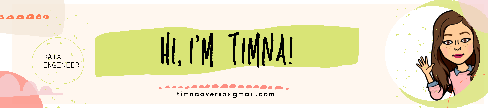
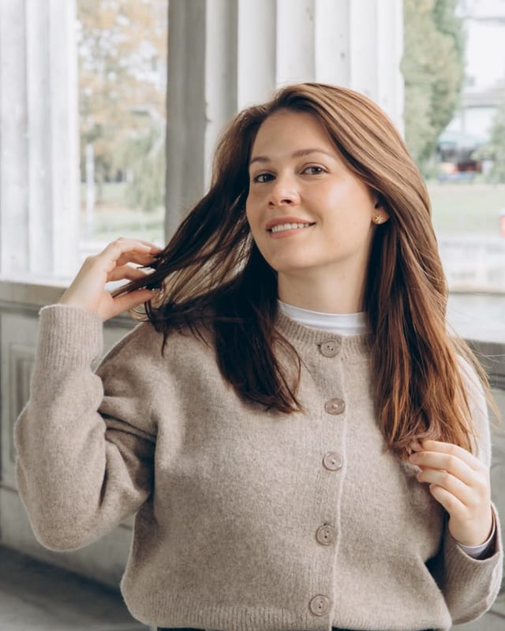

- 🔭 I'm a data engineer in Berlin, growing into **AI engineering**.
- 🌱 I'm currently learning how to design, build and ship AI-powered applications, on top of the data engineering foundations I already have: pipelines, warehouses, data quality and cloud platforms.
- 📣 I'm learning in public: follow my "Day X of learning AI engineering" recaps on [Instagram](https://www.instagram.com/that.girl.engineer/), and my podcast and videos, *That Girl Engineer*, on [Spotify](https://open.spotify.com/show/5ooDfgQxMgrn1Ygd1R8bqy) and [YouTube](https://www.youtube.com/@that.girl.engineer).
- 🛠️ What I work with: Python, SQL, Airflow, dbt, Snowflake, Databricks, AWS, plus knowledge of Azure and GCP.
- 👯 I'm looking to collaborate on open source that is beginner friendly.
- 🤔 I'm looking for help finding great projects to grow my skills, be it with Python, SQL, Airflow, cloud platforms or AI engineering.
- 💬 Ask me about any open project where you think my skills can help.
- 📫 How to reach me: timnaaversa@gmail.com or [LinkedIn](https://www.linkedin.com/in/timna-aversa/)
- 😄 Pronouns: She/Her
- ⚡ Fun fact: I love photography and playing board games as well as programming. I'm a very communicative person who loves to have a laugh :P

**My website:** https://tiaversa.github.io/tiaversa/ · **My CV:** [read it online](https://tiaversa.github.io/tiaversa/cv.html)

How the website is built

A retro desktop covered in journaling-zine stickers, with draggable, 3D-tilting paper windows. No build step, no dependencies.

- `index.html`: all the content (About Me, My CV, That Girl Engineer, My Pictures, Contact)
- `cv.html` and `cv/Timna_Aversa_CV.pdf`: the CV as a web page and a one-page PDF (printed from `cv.html`; no phone number on the public version)
- `js/links.js`: every link on the site; empty ones show a "soon" tag until filled in
- `css/style.css`, `css/cv.css`, `js/main.js`: styling, windows, 3D tilt and photo viewer
- `fonts/`: Amatic SC, Patrick Hand and Josefin Sans (SIL Open Font License, licences included)
- `images/timna-avatar.png`: cropped from the GitHub banner
- `images/thumbs` and `images/gallery`: web-sized copies of the photos; the originals stay in `images/`

On narrow screens the windows stack into a normal scrolling page.

